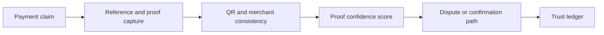

  

  

  
  
  

# UPI Social Proof Ledger

**AI verification layer for payment claims, QR trust and social-commerce proof.**

This repository is a public concept showcase. It explains the product thesis, trust model, payment-proof workflow, AI/ML role and investor-facing roadmap. It does not expose proprietary source code, verification rules, prompts, scoring logic, datasets, credentials, payment simulation internals or production integrations.

---

## Why this matters

Social commerce and small-merchant selling often rely on screenshots, verbal confirmations and informal proof. Payment proof can become hard to verify when buyers, sellers, QR codes, references and screenshots move across chat-based channels.

The market gap is not only payment confirmation. The gap is verifiable payment confidence for informal commerce.

## Product thesis

UPI Social Proof Ledger creates a trust layer for payment claims. It analyses claim consistency, QR identity, reference structure, merchant context and proof confidence to support cleaner buyer-seller communication and faster dispute handling.

---

## Concept flow

## Investor-grade capability map

| Layer | Capability | Value |
|---|---|---|
| Market | Social-commerce payment trust | Supports informal seller economy |
| Product | Proof and QR verification workflow | Reduces confusion and disputes |
| AI/ML | Screenshot/reference anomaly analysis | Improves proof confidence |
| Platform | Verification API for commerce flows | Can plug into chat, merchant and delivery tools |
| Governance | Privacy-aware evidence trail | Avoids unnecessary exposure of payment data |

---

## What visitors should understand in 60 seconds

- Small merchants need payment confidence, not only payment speed.
- Social commerce creates proof gaps that traditional payment apps do not fully solve.
- The product can verify claims without revealing sensitive payment infrastructure.
- Synthetic scenarios can validate the trust layer before regulated integrations.
- Proprietary verification rules and scoring logic are intentionally not public.

## Success metrics

| Metric | Why it matters |
|---|---|
| Proof confidence accuracy | Product credibility |
| Dispute reduction | Merchant value |
| Seller trust score uplift | Adoption signal |
| Time to confirm claim status | Operational value |

## Validation scenarios

- Old screenshot reused as proof
- Wrong reference number shared in chat
- QR identity mismatch
- Partial payment claim
- Buyer-seller mismatch
- Ambiguous payment status after network delay

## Positioning

UPI Social Proof Ledger sits at the intersection of UPI, social commerce, merchant trust, proof verification and AI-assisted dispute reduction.

**Owner:** [Prashant Jagtap](https://github.com/jprbom)  
**Repository type:** Public showcase, proprietary concept
