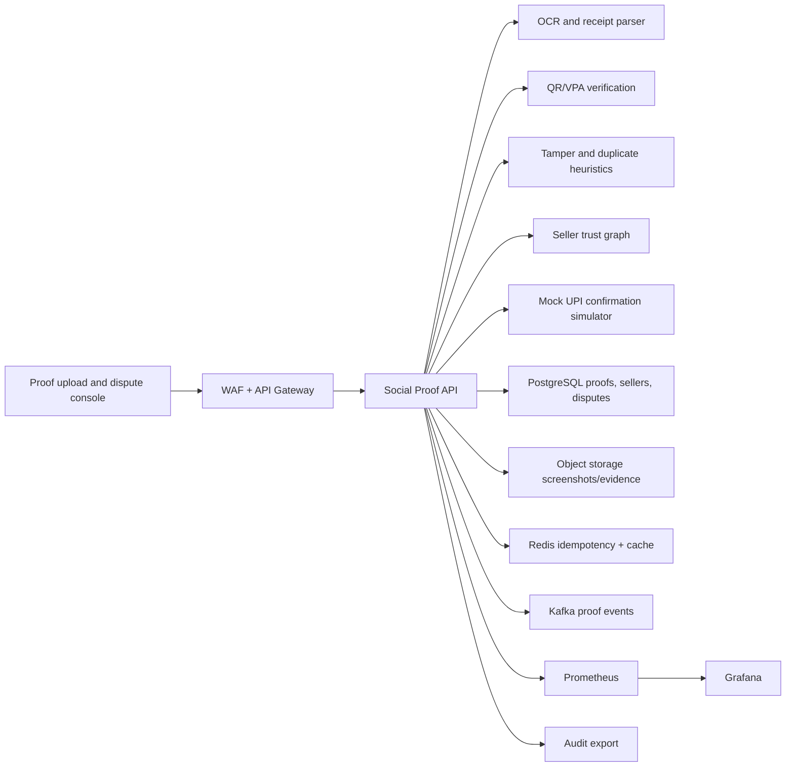
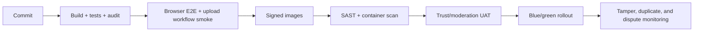

# Enterprise Cloud Deployment

Author: Prashant Jagtap <jprbom@gmail.com>

This repository is a runnable portfolio MVP today. The enterprise target is a payment-proof verification layer for social commerce, fake UPI receipt disputes, QR/VPA mismatch checks, duplicate proof detection, and seller trust evidence.

## Reference Architecture



## Cloud Mapping

| Layer | AWS | Azure | GCP |
| --- | --- | --- | --- |
| Runtime | EKS/ECS/Fargate | AKS/Container Apps | GKE/Cloud Run |
| Object evidence | S3 | Blob Storage | Cloud Storage |
| Database | RDS PostgreSQL | Azure PostgreSQL | Cloud SQL |
| Queue | MSK/SQS | Event Hubs/Service Bus | Pub/Sub |
| OCR target | Textract | Azure AI Vision | Document AI/Vision AI |
| Observability | CloudWatch/Grafana | Azure Monitor/Grafana | Cloud Monitoring |

## Production Social Proof Differentiators

- Screenshot upload with OCR extraction and UTR parsing.
- QR decode and VPA/name mismatch validation.
- Duplicate receipt detection through perceptual hash and metadata checks.
- Tamper heuristics for compression mismatch, template mismatch, and edited-field inconsistency.
- Dispute evidence pack for sellers, buyers, and moderators.

## Required Variables

```text
NODE_ENV=production
PORT=4105
CORS_ORIGIN=https://social-proof-ledger.example.com
DATABASE_URL=postgresql://...
REDIS_URL=redis://...
KAFKA_BROKERS=broker-1:9092
PROOF_BUCKET=upi-proof-evidence
OIDC_ISSUER=https://issuer.example.com
OIDC_AUDIENCE=upi-social-proof-api
```

## Security Controls

The current app uses synthetic proof signals. Enterprise deployment must add OIDC/JWT auth, tenant isolation, signed upload URLs, malware scanning, object retention policy, immutable audit logs, and strict PII redaction for screenshots and payment messages.

## Data Model Target

```text
tenants, users, roles, permissions
proof_uploads, receipt_ocr_results, qr_decode_results
vpa_match_results, tamper_checks, duplicate_hashes
seller_profiles, dispute_cases, evidence_packs
decision_reason_codes, model_versions, audit_logs
```

## Deployment Flow



## Observability

Operational endpoints:

- `GET /api/live`
- `GET /api/ready`
- `GET /api/metrics/prometheus`

Dashboards should track OCR latency, QR mismatch rate, duplicate proof rate, tamper score distribution, evidence-pack generation, seller risk trend, RBAC denials, object storage errors, and audit export success.

## Enterprise Readiness Checklist

- Add real screenshot upload, OCR, QR decoding, and tamper checks.
- Replace JSON persistence with PostgreSQL migrations.
- Add signed object URLs and evidence retention policy.
- Add OpenAPI schemas and CI E2E.
- Add model card and false-positive review workflow.
